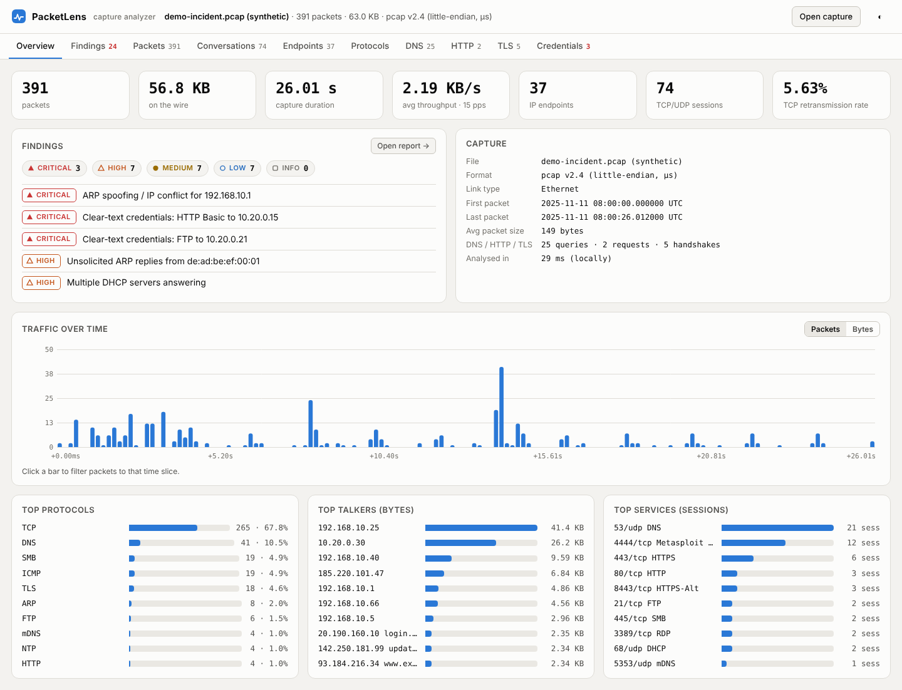
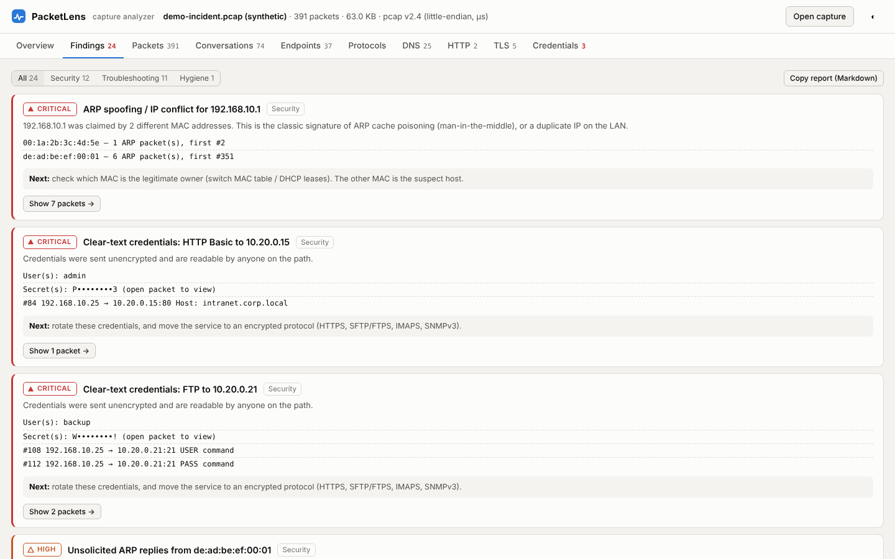
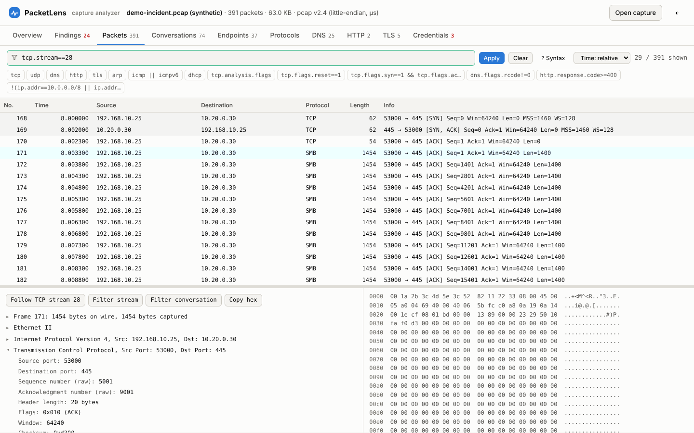

# PacketLens

**A packet capture analyzer for network forensics and troubleshooting that runs entirely in your browser.**

Drop in a `tcpdump` or Wireshark capture and PacketLens decodes it, builds conversations and endpoints, extracts DNS/HTTP/TLS details, and writes an automatic **findings report** covering both security incidents and network performance problems. The capture never leaves your machine: there's no server, no upload and no install, just one HTML file.



## Quick start

- **Use it online:** open the GitHub Pages site for this repo (see *Deploying* below), or
- **Use it offline:** download `index.html` and open it in any modern browser (Chrome, Edge, Firefox, Safari).

Click **Try the demo capture** to explore a synthetic incident (port scan, ARP spoofing, C2 beaconing, DNS tunnelling, clear-text credentials, TCP retransmissions…), or drop your own file.

```bash
# capture something to analyse
sudo tcpdump -i eth0 -s 0 -w capture.pcap
```

## Supported input

| | |
|---|---|
| File formats | pcap (little/big-endian, µs/ns), pcapng (multi-section, multi-interface, `if_tsresol`), gzip-compressed (`.pcap.gz`) |
| Link layers | Ethernet, 802.1Q / QinQ VLAN, Linux cooked SLL & SLL2 (`tcpdump -i any`), raw IPv4/IPv6, BSD/OpenBSD loopback |
| Protocols decoded | ARP, IPv4 (+fragments), IPv6 (+extension headers), TCP (options), UDP, ICMP, ICMPv6, DNS / mDNS / LLMNR, DHCP, NTP, SNMP, SSDP, Syslog, QUIC (header), HTTP/1.x, TLS (ClientHello/ServerHello, SNI, ALPN, versions, **JA3**), SSH, SMB1/SMB2, FTP, SMTP, POP3, IMAP, Telnet, plus port-based labels for ~90 services |

## Features

### Findings report


Findings are ranked by severity (critical → info). Each one comes with evidence, a recommended next step, and a one-click jump to the packets involved. You can export the report as Markdown.

**Security**
- ARP spoofing / IP conflicts and unsolicited ARP replies
- Rogue DHCP servers
- Vertical port scans (including SYN half-open detection), horizontal host sweeps, ICMP ping sweeps
- Periodic **C2 beaconing** (regular-interval connections with low jitter)
- **DNS tunnelling** (long, high-entropy subdomains), TXT-heavy domains, NXDOMAIN storms (DGA)
- **Clear-text credentials**: HTTP Basic and login forms, FTP, POP3, IMAP, SMTP AUTH PLAIN, SNMP community strings, Telnet
- Traffic to known-suspicious ports (4444, 31337, IRC, Tor, mining pools…)
- Scanner / scripting user-agents (nmap, sqlmap, curl, python-requests…) and attack-pattern URIs
- TLS without SNI, and large outbound transfers to the internet

**Troubleshooting**
- TCP retransmission rate, duplicate ACKs, zero-window stalls, keep-alives
- Unanswered SYNs (firewall drops), refused connections, mid-session resets
- Slow TCP handshakes (RTT), slow / unanswered / SERVFAIL DNS
- HTTP 4xx/5xx, fatal TLS alerts, ICMP unreachable / TTL exceeded / fragmentation-needed

**Hygiene**
- TLS 1.0/1.1 and SSL, SMBv1, plain HTTP to the internet, snaplen truncation

### Packet view


- A virtualised packet list that stays fast on large captures, with row colouring like Wireshark's
- A layer tree linked to the hex dump: click a layer and its bytes are highlighted
- **Follow TCP/UDP stream** in ASCII or hex
- Wireshark-compatible **display filters**:

```
ip.addr==10.0.0.0/8 && tcp.port==443
tcp.analysis.flags
tcp.flags.syn==1 && tcp.flags.ack==0
dns.qry.name contains "corp"
tls.handshake.extensions_server_name matches "microsoft|azure"
tcp.dstport in {22 23 3389 5900}
frame contains "password"
host 10.0.0.5 and port 53          # tcpdump/BPF-style shorthand
```

### Other views
Overview dashboard (KPIs, traffic timeline, top protocols/talkers/services) · Conversations (TCP/UDP sessions with state, RTT and retransmissions; IP pairs) · Endpoints (scope, names seen, MACs, TTLs) · Protocol hierarchy · DNS · HTTP · TLS (JA3) · Credentials. Every table is sortable, searchable and can be copied as CSV.

## Project layout

```
index.html            ← the app (self-contained, demo capture embedded)
tools/template.html   ← source of the app (edit this)
tools/build.py        ← embeds samples/sample.pcap into template → index.html
tools/gen_sample.py   ← generates the synthetic demo capture
samples/              ← demo capture in pcap and pcapng format
```

Rebuild after editing:

```bash
python3 tools/gen_sample.py   # optional: regenerate the demo capture
python3 tools/build.py
```

## Deploying (GitHub Pages)

The included workflow (`.github/workflows/pages.yml`) publishes `index.html` on every push to `main`. To turn it on, go to **Settings → Pages → Build and deployment → Source: GitHub Actions**.

## Limitations

- Application parsing happens per packet: HTTP or TLS content split across TCP segments isn't reassembled (Follow Stream does join it)
- No 802.11/radiotap decoding, TLS certificate parsing or file carving yet
- Stream numbers are shared between TCP and UDP (Wireshark numbers them separately)
- Very large captures (roughly 500 MB and up) are limited by browser memory; split them first with `editcap -c`

## Privacy

All parsing happens in JavaScript in your browser. The page makes no network requests apart from loading web fonts.

## License

MIT. See [LICENSE](LICENSE).
